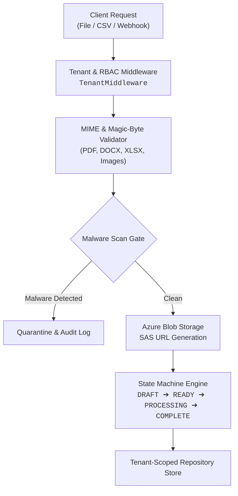

<div align="center">

# 🛡️ SPARC Multi-Tenant Submission Intake & Workflow Platform

**Enterprise multi-tenant submission intake, validation, and workflow state machine platform built with FastAPI, Azure Blob Storage, and strict RBAC isolation.**

[](https://fastapi.tiangolo.com)
[](https://python.org)
[](https://azure.microsoft.com)
[](https://fastapi.tiangolo.com)

</div>

---

## 📌 Architectural Overview

SPARC is a multi-tenant submission intake platform engineered with strict logical isolation, dynamic RBAC authorization, automated MIME/magic-byte malware quarantine scanning, and Azure Blob storage integration with 24-hour SAS token generation.



---

## ⚡ Core Highlights

- 🏢 **Strict Multi-Tenancy:** Automated tenant context resolution and scoped database repositories (`TenantScopedRepository`) ensuring complete data isolation between organizations.
- 🔐 **Granular RBAC:** Fine-grained role-based permissions (`SUBMIT_FILE`, `SUBMIT_CSV_IMPORT`, `SUBMIT_EMAIL`) enforced via dependency injection.
- 🔍 **Defensive Intake Validation:** Magic byte verification (PDF/DOCX/XLSX/PPTX/Images) and automated scanning before storage persistence.
- 📦 **Pluggable Storage Infrastructure:** Abstracted blob storage provider generating time-limited SAS tokens for secure file retrieval.
- 🔄 **Workflow State Machine:** Lifecycle tracking from `DRAFT ➔ READY ➔ PROCESSING ➔ REVIEW_PENDING ➔ COMPLETE`.

---

## 📁 Repository Structure

```text
spsProject/
├── app/
│   ├── auth/                     # RBAC permission models & validators
│   ├── db/                       # CosmosDB & Redis client providers
│   ├── middleware/               # Multi-tenant context middleware
│   ├── models/                   # Tenant, user role, and feature flag models
│   ├── routers/                  # Tenant management and intake REST endpoints
│   ├── schemas/                  # Pydantic schemas for payload validation
│   └── services/                 # Audit, feature flags, and tenant services
├── sparc/
│   ├── domain/                   # Role and submission entity definitions
│   ├── infrastructure/           # Azure Blob storage adapters
│   └── services/                 # Submission intake & workflow state services
├── tests/                        # Integration & cross-tenant isolation test suite
├── Dockerfile                    # Container definition
├── requirements.txt
└── main.py
```

---

## 🚀 Quickstart

```bash
# Clone repository
git clone https://github.com/2r41r43r34g1rvcqdsad/spsProject.git
cd spsProject

# Setup virtual environment
python -m venv venv
source venv/bin/activate  # Or .\venv\Scripts\activate on Windows

# Install dependencies
pip install -r requirements.txt

# Run server
uvicorn app.main:app --reload --port 8000
```

---

## 👤 Author

**Kapil Kumar Mishra**
- **Role:** Data & AI Engineer
- **LinkedIn:** [Kapil Kumar Mishra](https://www.linkedin.com/in/kapil-kumar-mishra-490b981b4)
- **GitHub:** [@2r41r43r34g1rvcqdsad](https://github.com/2r41r43r34g1rvcqdsad)
- **Email:** mishrakap9685@gmail.com